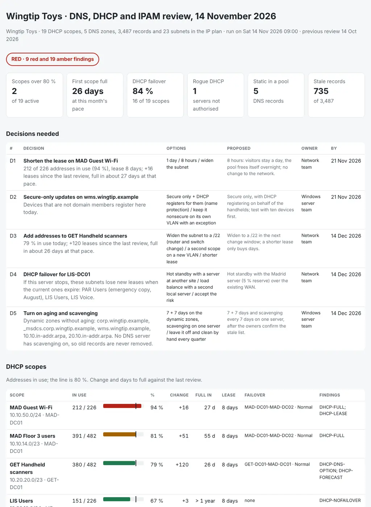

# DNS, DHCP and IPAM Review

The question for the network and Windows server teams every month: will every device get an address and find the servers it needs? Is any scope about to run out, is failover working, are clients pointed at a DNS server that no longer exists, can anyone overwrite a name, and does the IP address plan match what is configured? From the Windows Server DHCP scopes, options, reservations, leases and failover relationships, the DNS servers, zones and records, the IP address plan and the exceptions register, it puts together:

- **DHCP:** how full every scope is and when it will be full at this month's pace; failover relationships and the scopes outside them; the DNS servers and gateway each scope hands out; lease lengths against the standard for guest, Wi-Fi and user subnets; duplicate and stale reservations; the same subnet served by two servers; and DHCP servers not authorised in Active Directory.
- **DNS:** zones that accept nonsecure updates; aging and scavenging; stale and duplicate dynamic records; static records inside a DHCP pool; records that still point to a retired domain controller; missing reverse records; forwarders; and aliases that point to nothing.
- **The IP address plan:** scopes that are not in the plan, planned subnets with no scope, overlapping subnets, subnets with no owner and subnets with no reverse lookup zone.
- **Exceptions:** valid ones are accepted; expired, expiring and incomplete ones (no approver, ticket or expiry) come back as findings.

Every finding has an owner and a due date, the ones that need a choice (a scope that is filling up, a nonsecure zone, scavenging, failover for a site) become **decisions**, and the pack carries the evidence an ISO 27001 or NIS2 auditor asks for about the network services: **what is configured, what is at risk, and what we fix first.**

Python 3.10+, standard library only. It runs with fictional demo data out of the box. A read-only PowerShell script exports everything from the DHCP and DNS servers.

The review sits next to two earlier repos in the series: [45-network-config-compliance](https://github.com/inigogonzalezgarcia/45-network-config-compliance) checks the switch and firewall configurations, and [51-windows-server-baseline-drift](https://github.com/inigogonzalezgarcia/51-windows-server-baseline-drift) checks the Windows servers themselves.



## Why

DHCP and DNS work until the day they do not, and the reasons build up quietly. In a typical month:

- the guest Wi-Fi keeps the default 8-day lease, and by the second week of a busy month visitors cannot connect;
- sixty new handheld scanners arrive for the peak season and their scope will be full before Christmas;
- a domain controller is retired, but five scopes still hand it out as a DNS server and its SRV records are still there;
- the link to a site drops after a firewall change and the DHCP failover partners stop replicating;
- a scope created during an outage in August is still active on another server;
- someone plugs a consumer router into the showroom network for a launch event;
- a vendor sets the handheld zone to accept nonsecure updates;
- a technician gives four printers a static address in the middle of the DHCP pool;
- nobody has scavenged since the server that did it was retired, and hundreds of old records point to addresses now used by other devices;
- the IP plan says one thing, the scopes another.

Each console shows its own part. The review reads them together and turns the result into a short list of fixes and decisions. The rules are in `settings.json` and `dnsdhcpreview/checks.py`.

## What it checks

| Area | Code | Finding | Severity |
|---|---|---|---|
| Scopes | DHCP-FULL | 90 % of the pool in use; 80 % | RED; AMBER |
| Scopes | DHCP-FORECAST | Full within 30 days at the growth since the last review | AMBER |
| Failover | DHCP-FAILOVER, DHCP-NOFAILOVER | Relationship not in Normal state; scopes in no relationship | RED; AMBER |
| Options | DHCP-DNS-OPTION, DHCP-ROUTER | Option 006 with a server that is not a live DNS server; option 003 missing or outside the subnet | RED; AMBER |
| Leases | DHCP-LEASE | Longer than the standard for guest, Wi-Fi, scanner or user subnets | AMBER |
| Reservations | DHCP-RESV-DUP, DHCP-RESV-STALE | The same device reserved twice; no device behind a reservation | AMBER |
| Servers | DHCP-OVERLAP, DHCP-ROGUE | The same subnet active on two servers without failover; a DHCP server not authorised in AD | RED |
| Zones | DNS-INSECURE, DNS-AGING | Nonsecure dynamic updates; aging off or no server scavenging | RED; AMBER |
| Records | DNS-STATIC-POOL, DNS-OLD-DC | A static address inside a DHCP pool; records of a retired domain controller | RED |
| Records | DNS-STALE, DNS-PTR, DNS-CNAME | Stale dynamic records; static records with no PTR; aliases to nothing | AMBER |
| Servers | DNS-FORWARDERS | Forwarders different from the standard | AMBER |
| IP plan | IPAM-OVERLAP | Overlapping subnets | RED |
| IP plan | IPAM-UNDOC, IPAM-NOSCOPE, IPAM-NOOWNER, IPAM-REVERSE | Scope not in the plan; planned DHCP subnet with no scope; no owner; no reverse zone | AMBER |
| Exceptions | EXC-EXPIRED | Expired and the gap still there | RED on the RED checks; AMBER otherwise |
| Exceptions | EXC-EXPIRING, EXC-INCOMPLETE | Expiring within 30 days; no approver, ticket or expiry (it does not count) | AMBER |

[docs/data-format.md](docs/data-format.md) has every rule, column and setting.

## Outputs

| File | What |
|---|---|
| `report.html` | Tiles (scopes over 80 %, days until the first scope is full, failover coverage, rogue DHCP servers, static records in a pool, stale records), the decisions, every scope with how full it is, the change and days to full, lease and failover, the DNS zones, the IP plan reconciled, the exceptions and every finding |
| `review-pack.md` | One page for the monthly infrastructure review: headlines, scopes to watch, decisions needed, actions with owner and date, the zones, the audit evidence summary, scope and notes |
| `scopes.csv` | One row per scope: site, purpose, size, in use, change, days to full, lease, failover and state, DNS servers and router handed out, findings; next month's `previous-scopes.csv` |
| `reservations-review.csv` | Every reservation with whether its device is on the network and what to review |
| `dns-zones.csv` | Every zone with updates, aging, records, dynamic, static and stale |
| `stale-records.csv` | Every stale dynamic record with its age and whether the name has a newer record |
| `ip-plan-review.csv` | Every subnet in the plan and every scope, matched, with the reverse zone and what is missing |
| `exceptions-review.csv` | Every exception with its state (valid, expiring, expired, incomplete, not needed) and the action |
| `findings.csv`, `actions.csv` | Every finding with severity, items, owner and due date; the same as actions with a reference and a done column |

## Try it

```bash
git clone https://github.com/inigogonzalezgarcia/53-dns-dhcp-ipam-review.git
cd 53-dns-dhcp-ipam-review
python -m dnsdhcpreview demo
```

Open `output/report.html` and `output/review-pack.md`.

### The demo data

The demo is a made-up toy retailer and distributor, Wingtip Toys, with a head office in Madrid, a distribution centre in Getafe and offices in Lisbon and Paris: five domain controllers that run DNS and DHCP, 19 scopes and the domain `corp.wingtip.example`. The review runs on Saturday 14 November 2026; the previous one was on 14 October:

- 19 scopes with 3,118 active leases, 190 reservations, 57 options, 3 failover relationships, 5 zones with 3,487 records, 23 subnets in the IP plan and 5 exceptions.

Everything is fictional: servers, devices, addresses and tickets. The problems are placed on purpose among scopes and records that are fine:

- **Scopes:** the Madrid guest Wi-Fi at 94 % with an 8-day lease; the third floor in Madrid at 81 %; the Getafe handheld scanners at 79 % but 120 devices up in a month, full in about 26 days.
- **Failover:** Paris and its Madrid partner in `CommunicationInterrupted`; Lisbon with no failover, and its exception expired on 31 October.
- **A retired domain controller:** MAD-DC03, removed in September, still handed out as DNS server by the 5 Getafe scopes, with 6 records (A, NS, SRV, PTR) still pointing to it; it was also the only server that scavenged.
- **Leftovers and strangers:** an emergency copy of the Paris users scope from August still active in Lisbon, and a consumer router answering DHCP on the Paris showroom VLAN, seen by DHCP snooping.
- **Records:** the handheld zone with nonsecure updates (its exception has no approver), 735 stale records, 5 printers with a static address inside the pool (a sixth has a valid exception), 15 static records with no PTR and 3 aliases that point to retired hosts.
- **Plan and options:** the new meeting room AV scope with no gateway and not in the plan, a planned guest subnet in Lisbon with no scope, the Paris showroom and its printers overlapping in the plan, 3 subnets with no owner and no reverse zones for Lisbon and Paris.

The result: **RED**; 2 of 19 scopes over 80 % and the first one full in about 26 days at this month's pace; failover on 16 of 19 scopes; 9 red and 19 amber findings and 5 decisions: a shorter lease on the guest Wi-Fi, secure updates for the handheld zone, more addresses for the scanners, failover for Lisbon, and aging and scavenging.

## Use it with your own data

1. Export (read-only), from a workstation with the DHCP and DNS RSAT tools:
   ```powershell
   Copy-Item .\output\scopes.csv .\data\previous-scopes.csv     # last month's scopes, for the growth and the forecast
   .\scripts\Export-DnsDhcp.ps1 -OutputFolder .\data
   ```
   - DHCP: `Get-DhcpServerInDC`, `Get-DhcpServerv4Scope`, `Get-DhcpServerv4ScopeStatistics`, `Get-DhcpServerv4OptionValue`, `Get-DhcpServerv4Reservation`, `Get-DhcpServerv4Lease` and `Get-DhcpServerv4Failover` on every authorised server (or `-DhcpServers`); scopes in a failover relationship are exported once. `-SkipLeases` leaves the leases out on very large estates (the stale reservation check is then skipped).
   - DNS: `Get-DnsServerScavenging` and `Get-DnsServerForwarder` on every domain controller (or `-DnsServers`), and `Get-DnsServerZone`, `Get-DnsServerZoneAging` and `Get-DnsServerResourceRecord` from the first one.
2. Add the files only you have:
   - `ip-plan.csv` from your IP address plan or IPAM (subnet, site, VLAN, purpose, owner, DHCP yes or no);
   - retired DNS servers in `dns-servers.csv` with Status `Decommissioned <date>`, and any DHCP server seen by DHCP snooping or a scan in `dhcp-servers.csv`;
   - `exceptions.csv` from your exceptions register, and `data/settings.json`: dates, thresholds, lease standards, approved forwarders and owners ([docs/data-format.md](docs/data-format.md) has every column and setting).
3. Build the outputs:
   ```bash
   python -m dnsdhcpreview review data/
   ```

[docs/review-runbook.md](docs/review-runbook.md) has the monthly cycle, how to read the result (availability first, then name resolution, then hygiene), when to fix, accept an exception or decide, how to change leases, scopes, secure updates and scavenging without surprises, and the evidence for audits.

The exports contain server names, internal addresses, device names and MAC addresses. Keep them inside your organisation:

- real files at the top level (`dhcp-*.csv`, `dns-*.csv`, `ip-plan*.csv`, `exceptions*.csv`, `previous-scopes*.csv`, `settings.json`, `data/`, `downloads/`) and the `output/` folder are excluded from Git by `.gitignore`;
- only the fictional files in `sample_data/` are committed.

## Tests

```bash
pip install -r requirements-dev.txt
python -m pytest -q
```

GitHub Actions runs them on Python 3.10 and 3.12 on every push, then rebuilds the fictional sample data and the report screenshot from the simulator.

13 tests: the parsers (MAC addresses, durations, networks, update modes, subnet purposes, reverse zones, names); a clean estate with no findings; loading other column names; utilisation and the forecast window; failover, DHCP options, overlaps, leases and rogue servers; reservations; DNS hygiene (nonsecure zones, aging, stale records, static records in a pool, a retired domain controller, PTR records, forwarders, aliases); the IP plan; the exception states; the settings and a missing required file; the demo numbers and its decisions; a deterministic demo; and every output, with this month's `scopes.csv` loading as next month's previous scopes.

## Next steps

- Run it on the first working day of every month, and before and after every network change at a site.
- Keep each month's `scopes.csv` to show the growth per site over the year when you plan the network budget.
- Read the IP plan straight from the Windows Server IPAM role or another IPAM tool instead of a CSV.
- Add the IPv6 scopes and zones, and the DHCP audit logs to see address conflicts as they happen.
- Open the RED actions as tickets in the ITSM tool with the owner and due date.

## Background

Built from my work running Windows infrastructure and networks:

- DNS and DHCP on Windows Server, Active Directory and group policy;
- Cisco switches and routers, FortiGate firewalls, communications rooms and multi-site networks;
- PowerShell automation and monitoring;
- applied experience with ISO 27001 and NIS2, answering audits, and process ownership for incident, change and problem.

Written from scratch with fictional data; no employer data, systems or exports are used.

## Customisation and contact

Want this adapted to your environment? For example:

- your thresholds, lease standards and forwarders;
- your sources: another IPAM tool, Infoblox or BIND exports, your CMDB;
- your exception rules and owners;
- the pack in the format of your monthly infrastructure review.

Get in touch:

- Website (contact form): [inigogonzalezgarcia.github.io](https://inigogonzalezgarcia.github.io/about.html#contacto)
- LinkedIn: [linkedin.com/in/igonzalez93](https://www.linkedin.com/in/igonzalez93)

## License

MIT
